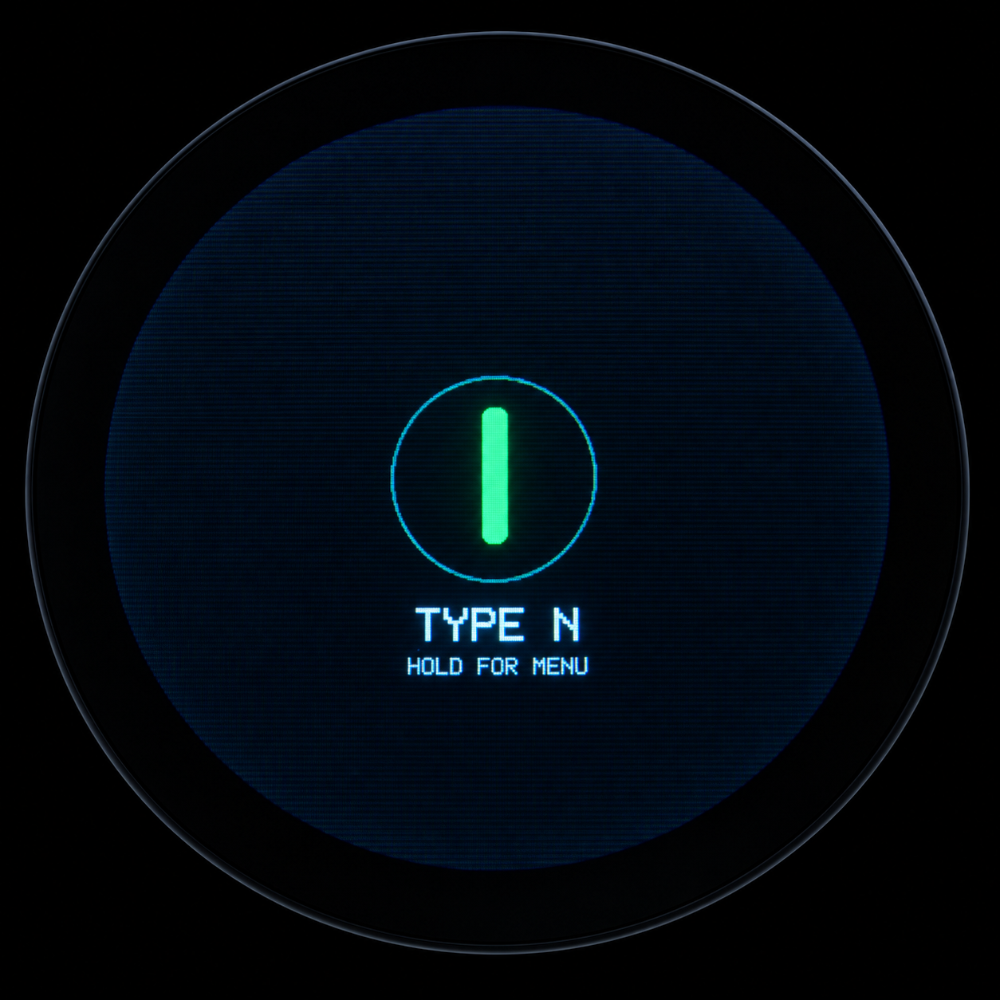
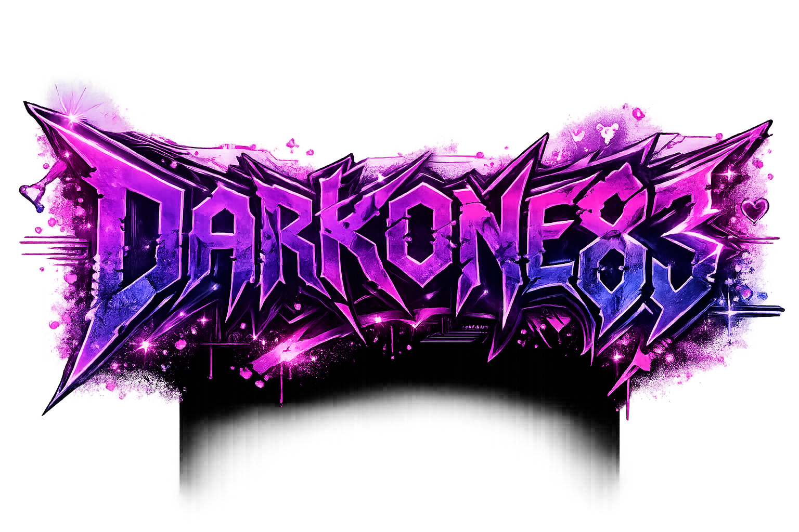

# TypeN

<div align=center>



 

</div>

**TypeN** is an ESP32-P4-powered 800×800 round media display with touch control, SD-backed media playback, local Wi-Fi management, and rollback-safe firmware updates.

The project is designed around a simple goal: load media onto the device, choose what to display, and manage it locally without requiring an external router or Internet connection.

---

## Highlights

- 800×800 round MIPI-DSI display
- Direct framebuffer UI with touch control
- JPEG, PNG, and animated GIF playback
- Center-cover rendering for mixed aspect ratios
- JPEG EXIF orientation handling
- Recursive SD-card media discovery
- Persistent selected media
- Local thumbnail browser and cache
- Browser-based media upload, selection, and deletion
- Local SoftAP and captive-portal style access
- Browser and SD-card firmware updates
- Dual OTA slots with ESP-IDF rollback support
- Separate firmware configurations for:
  - **P4 Pico + external C6 slave**
  - **P4 Pico WiFi / onboard C6**

---

## Hardware

TypeN targets the ESP32-P4 platform and the 800×800 JD9365 round display used by the Waveshare P4 ecosystem.

Typical TypeN hardware includes:

- ESP32-P4 host
- JD9365 800×800 MIPI-DSI display
- GT9xx touch controller
- microSD storage
- ESP32-C6 Wi-Fi coprocessor
- 32 MB application flash layout
- PSRAM-backed media and framebuffer workloads

---

## Supported hardware configurations

TypeN supports two ESP32-C6 arrangements.

### P4 Pico + external C6 slave

The discrete P4 Pico configuration uses **ESP-Hosted over UART**.

| ESP32-P4 | Direction | ESP32-C6 |
|---|---|---|
| GPIO18 — TX | P4 → C6 | GPIO20 — RX |
| GPIO19 — RX | C6 → P4 | GPIO21 — TX |
| GPIO54 — Reset | P4 → C6 | EN / CHIP_PU |
| GND | Common | GND |

```text
ESP32-P4 Pico                         ESP32-C6 Slave
────────────────────────────────────────────────────────

GPIO18  TX  ───────────────────────► GPIO20  RX
GPIO19  RX  ◄─────────────────────── GPIO21  TX
GPIO54      ───────────────────────► EN / CHIP_PU
GND         ──────────────────────── GND
```

The P4 and C6 may share the same 5 V / USB supply, but **do not connect the two regulated 3.3 V outputs together**.

The external C6 may keep its USB connection available for initial flashing, recovery, and serial diagnostics.

See [C6_Slave_Wiring.md](C6_Slave_Wiring.md) for the complete wiring and bring-up guide.

### P4 Pico WiFi / onboard C6

The onboard-C6 variant uses the board's native **4-bit SDIO** connection rather than the external UART wiring above.

Current P4-side Hosted SDIO configuration:

| Signal | ESP32-P4 GPIO |
|---|---:|
| CLK | 18 |
| CMD | 19 |
| D0 | 14 |
| D1 | 15 |
| D2 | 16 |
| D3 | 17 |
| C6 Reset | 54 |

The two variants therefore use separate ESP-Hosted firmware configurations:

```text
P4 Pico + external C6
    ESP-Hosted UART

P4 Pico WiFi / onboard C6
    ESP-Hosted SDIO
```

Do not mix the UART slave firmware/configuration with the onboard SDIO variant.

---

## Software requirements

- **ESP-IDF 5.5.1**
- ESP32-P4 toolchain
- Matching ESP32-C6 slave firmware for the selected hardware variant

TypeN intentionally stays on ESP-IDF 5.5.1 for the current hardware/software baseline.

---

## Building

From an ESP-IDF 5.5.1 environment:

```bash
idf.py set-target esp32p4
idf.py build
```

For an already-configured source tree, avoid replacing `sdkconfig` unless you are intentionally changing the hardware variant.

The P4 Pico and P4 Pico WiFi builds should use separate configuration/source trees so their ESP-Hosted transport settings remain unambiguous.

### Firmware version

Set an explicit release version before producing public firmware.

Preferred approaches:

```text
version.txt
```

or:

```cmake
set(PROJECT_VER "x.y.z")
```

The embedded version is shown in the TypeN web interface and startup log.

---

## First installation

A new board should receive a **full USB/UART flash** so the bootloader, partition table, OTA metadata, and factory application are installed together.

Typical development flow:

```bash
idf.py build
idf.py flash
idf.py monitor
```

Do not introduce a new partition layout through an application-only OTA update.

For more detailed setup instructions, see [INSTALL.md](INSTALL.md).

---

## Flash layout

The current P4 layout uses 32 MB flash:

| Partition | Type | Offset | Size |
|---|---|---:|---:|
| NVS | data | `0x00009000` | 24 KB |
| PHY init | data | `0x0000F000` | 4 KB |
| Factory | app | `0x00010000` | 8 MB |
| OTA 0 | app | `0x00810000` | 8 MB |
| OTA 1 | app | `0x01010000` | 8 MB |
| OTA data | data | `0x01810000` | 8 KB |

Rollback support requires:

```text
CONFIG_BOOTLOADER_APP_ROLLBACK_ENABLE=y
```

---

## Boot behavior

TypeN initializes the local display/media path first so the device remains useful even when Wi-Fi is unavailable.

Expected startup sequence:

```text
display
→ touch / local UI
→ settings
→ playback
→ updater / rollback checkpoint
→ microSD
→ media scan
→ restore selected media
→ C6 / Wi-Fi
→ local web manager
```

A missing or unavailable C6 should not prevent local SD media playback on the external-UART configuration.

---

## SD-card layout

Recommended directories:

```text
/sdcard/typen/media/
/sdcard/typen/thumbs/
/sdcard/typen/update/
```

- `media/` — normal uploaded media
- `thumbs/` — TypeN-managed thumbnail cache
- `update/` — SD firmware update location

The media scanner is recursive, while the configured thumbnail-cache directory is excluded from the media library.

Default SD firmware path:

```text
/sdcard/typen/update/TypeN.bin
```

---

## Local web interface

TypeN exposes a local control surface through its ESP32-C6 Wi-Fi link.

Current network:

```text
SSID: TypeN Setup
Security: Open
Address: 192.168.4.1
```

The web interface provides:

- media library browsing
- media upload
- display selection
- delete confirmation
- brightness/settings control
- firmware update
- update status and rollback information
- firmware/build identity

No external router is required.

---

## Media support

TypeN currently supports:

- JPEG
- PNG
- animated GIF

Playback uses center-cover rendering so content fills the round 800×800 display without stretching.

The current JPEG path also honors EXIF orientation.

Local thumbnails are generated and cached separately from playback media, and the cache directory is excluded from recursive media discovery.

---

## Firmware updates

TypeN supports two application-update paths:

1. **Browser upload**
2. **SD-card update**

Normal application OTA uses:

```text
TypeN.bin
```

Do **not** use these as application OTA payloads:

```text
bootloader.bin
partition-table.bin
merged/full-flash images
```

Those belong to the full USB/UART flash workflow.

### Browser update

The browser updater preflights the firmware before the confirmation dialog.

It validates:

- ESP application image header
- application descriptor
- project identity
- full image size
- inactive OTA slot availability
- target-slot capacity

The full upload repeats the checks before opening the OTA writer.

Successful flow:

```text
UPLOAD
→ WRITE
→ VERIFY
→ REBOOT
→ CONFIRM
```

### SD update

The SD updater performs the same type of application/slot validation before installation and shows the current and target firmware information before the write begins.

See [UPDATE_RECOVERY.md](UPDATE_RECOVERY.md) for the full update and rollback behavior.

---

## OTA and rollback

Normal application updates rotate through the inactive OTA slots:

```text
factory
  ↓
ota_0
  ↓
ota_1
  ↓
ota_0
  ↓
...
```

A newly installed OTA image is not considered permanently valid immediately.

TypeN confirms the new image only after the core local system has initialized successfully. If the new firmware cannot reach that checkpoint, ESP-IDF can return to the previous working image.

The Update page reports:

- current firmware version
- running slot
- configured boot slot
- image state
- last update result
- last attempted/confirmed version
- rollback availability
- last invalid/aborted OTA image when available

---

## Recovery

If a firmware image fails preflight or final verification, the current running firmware remains active.

If a newly installed OTA image fails during its first boot before confirmation, the bootloader rollback path can return to the previous working image.

If OTA recovery is not available, perform a known-good full USB/UART flash:

```bash
idf.py build
idf.py flash
idf.py monitor
```

A full flash is also required whenever the bootloader or partition table changes.

---

## Project status

TypeN's current firmware baseline includes working display, touch, SD media, local UI, browser management, and rollback-safe application updates.

The hardware variant determines only how the ESP32-P4 communicates with the ESP32-C6:

```text
External C6       → UART
Onboard WiFi C6   → SDIO
```

Everything above that transport layer remains the same TypeN product experience.
